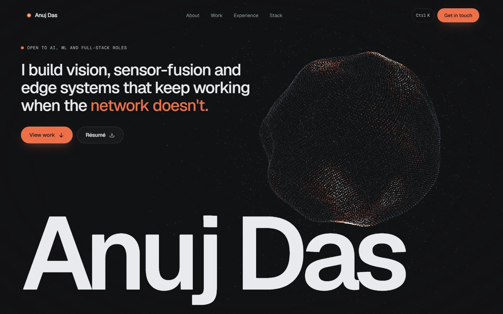
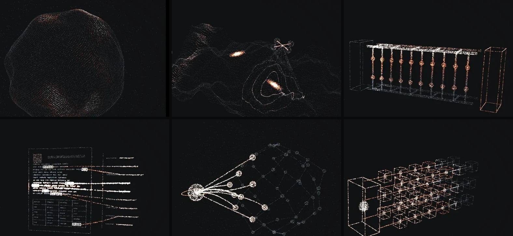
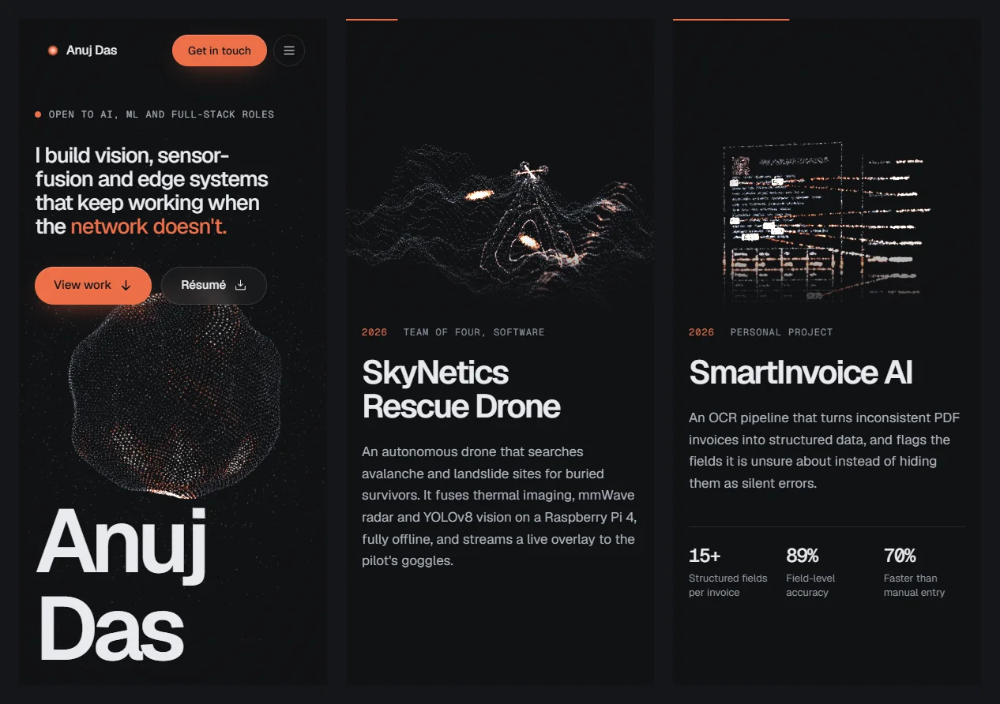

# Anuj Das, Portfolio

**Live site: [anujdas.vercel.app](https://anujdas.vercel.app)**



Personal portfolio of **Anuj Das**, AI and ML engineer (B.E. Computer Science, AI and ML, Easwari Engineering College, Chennai, class of 2027). One WebGL particle system sits behind the whole page and rebuilds itself into a 3D model of each project as you scroll.

## The idea



About 22,000 particles, coloured like a thermal camera (steel, then heat orange, then white-hot), take a different shape for each part of the page:

| Section | Formation |
| --- | --- |
| Hero | A sphere with drifting heat patches |
| SkyNetics Rescue Drone | Terrain with two heat signatures, radar rings and the drone's scanning cone |
| Chiller Valve Management | A hot and cold pipe network with 20 valves, like the real plant |
| SmartInvoice AI | An invoice being scanned, with extracted fields streaming into structured output |
| Shigotai | A candidate profile connected to its matched jobs in a wider job graph |
| EdgeGrid | A fleet of edge devices with a firmware rollout moving through it |
| Contact | A glowing ring |

## Featured work

| Project | What it is | Code |
| --- | --- | --- |
| SkyNetics Rescue Drone | Offline drone that finds people buried by avalanches and landslides, fusing thermal, mmWave radar and YOLOv8 vision on a Raspberry Pi 4 | [Repo](https://github.com/AnujD21/SkyNetics_RAS_Drone) |
| Chiller Valve Management | Live digital twin of an industrial chiller network at Larsen & Toubro | Internal (L&T) |
| SmartInvoice AI | OCR pipeline that extracts 15+ fields from PDF invoices with per-field confidence scores | Private |
| Shigotai | Career platform that explains how well you match live jobs at Japanese companies | [Repo](https://github.com/AnujD21/Shigotai) |
| EdgeGrid | Control plane for firmware rollouts and automatic rollback across mixed edge devices | [Repo](https://github.com/AnujD21/EdgeGrid) |

## Features

- **Scroll-driven 3D.** The formations morph as you scroll. Particles arc through space between shapes, a scan line sweeps across some of them, and they move away from your cursor.
- **Motion.** GSAP ScrollTrigger and SplitText for text reveals, an About paragraph that lights up word by word, count-up stats, and Lenis smooth scrolling.
- **Preloader.** It counts against real work (fonts and the WebGL scene), then lifts away while the particles fly in and assemble.
- **Command palette.** Press <kbd>Ctrl</kbd> + <kbd>K</kbd> (<kbd>⌘</kbd> + <kbd>K</kbd> on Mac) to jump to a section, copy the email address or download the résumé.
- **Details.** Magnetic buttons, film grain, a velocity-linked logo strip, hover text rolls and a scroll progress bar.
- **Responsive.** On phones each formation sits in a header band above its project, and the text slides over it on a solid sheet.
- **Accessible.** Honours reduced-motion settings, falls back gracefully without WebGL, and includes keyboard navigation, focus rings and a skip link.



## Tech stack

- **Framework:** React 19, TypeScript, Vite 8
- **Styling:** Tailwind CSS v4, Geist and Geist Mono fonts
- **3D:** Three.js, React Three Fiber, custom GLSL vertex and fragment shaders
- **Animation:** GSAP 3 (ScrollTrigger, SplitText, ScrambleText), Lenis
- **Icons:** Phosphor Icons, Simple Icons
- **Hosting:** Vercel

## How it works

1. **Formations are generated, not modelled.** `src/three/formations.ts` builds every shape procedurally from the same number of points, each with a "heat" value. A fixed random seed makes them identical on every load.
2. **Two shapes on the GPU at a time.** The current and next formations live in vertex attributes. When the scroll position crosses into the next pair, the buffers are swapped.
3. **The shader does the motion.** The vertex shader in `src/three/shaders.ts` blends the two shapes with a per-particle delay and a curved path. It also adds simplex-noise drift, the scan sweep, the cursor push and the intro scatter. The fragment shader maps heat onto the thermal colour ramp.
4. **Scroll drives the index.** Every element marked `data-formation` gets a ScrollTrigger. Their progress values add up to one continuous formation index (2.4 means 40% of the way from formation 2 to 3), which the render loop eases towards.
5. **Three.js loads lazily.** The 3D bundle loads behind the preloader, so the page itself stays light.

## Project structure

```
src/
  data/          All site content: profile, projects, experience, stack, credentials
  sections/      Page sections: Hero, About, Work, Experience, Stack, Credentials, Contact
  components/    Nav, Preloader, CommandPalette, RevealText, Counter, Magnetic and others
  three/         ParticleField (React Three Fiber), formations, GLSL shaders
  lib/           GSAP setup, Lenis scrolling, shared scene state, environment checks
  styles/        Tailwind v4 theme tokens and global styles
public/          Favicon, résumé PDF and project images
docs/            Screenshots used in this README
```

## Run it locally

Requires Node.js 20.19 or newer.

```bash
npm install
npm run dev       # start a dev server at http://localhost:5173
npm run build     # type-check and build to dist/
npm run preview   # serve the production build locally
```

## Editing content

All text lives in `src/data/`, so content changes don't touch layout code. If you add or remove a featured project, also add or remove its entry in `formationConfigs` and `generators` in `src/three/formations.ts`. Those lists are matched to the page sections by order.

## Deployment

The site is hosted on Vercel and Vercel detects the settings automatically:

- **Framework:** Vite
- **Build command:** `npm run build`
- **Output directory:** `dist`

## Credits

- 3D simplex noise GLSL by Ian McEwan, Ashima Arts ([webgl-noise](https://github.com/ashima/webgl-noise), MIT)
- Brand logos from [Simple Icons](https://simpleicons.org) (CC0)
- [Geist](https://vercel.com/font) fonts by Vercel (SIL Open Font License)
- Interface icons from [Phosphor](https://phosphoricons.com) (MIT)

## Contact

- Email: [anujdas2109@gmail.com](mailto:anujdas2109@gmail.com)
- LinkedIn: [in/anujdas2109](https://www.linkedin.com/in/anujdas2109)
- GitHub: [AnujD21](https://github.com/AnujD21)

© 2026 Anuj Das. The code is public for reference. The personal content (text, résumé and project images) belongs to Anuj Das and may not be reused.
